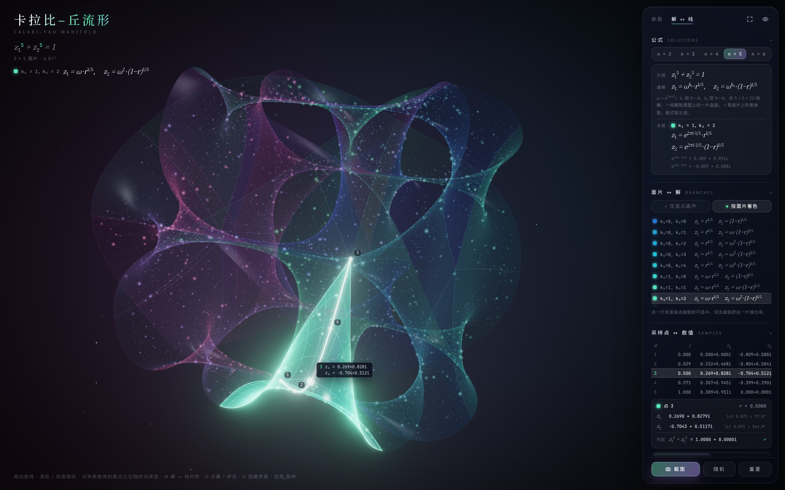

# 卡拉比–丘流形 · 交互模型

浏览器里可交互的卡拉比–丘（Calabi–Yau）流形可视化：五次超曲面截面、参数调节、面片分离/拼合，以及「解 ↔ 线」对照。单文件 HTML，已内联 three.js，**无需联网**即可打开。

## 在线演示（GitHub Pages）

开启 Pages 后访问：

https://frostcold.github.io/calabi-yau/

### 如何开启 GitHub Pages

1. 打开仓库 **Settings → Pages**
2. **Source** 选 **Deploy from a branch**
3. Branch 选 **`main`**，文件夹选 **`/`（根目录）**
4. 保存后等待一两分钟，站点即可上线

本仓库根目录的 `index.html` 即为演示页，适合从根目录发布。

## 本地打开

任选其一：

```bash
# 直接用浏览器打开
open index.html        # macOS
xdg-open index.html    # Linux

# 或起一个本地静态服务（推荐，避免部分浏览器对 file:// 的限制）
python3 -m http.server 8080
# 然后访问 http://127.0.0.1:8080/
```

## 仓库内容

| 路径 | 说明 |
|------|------|
| `index.html` | 成品演示（单文件，可离线） |
| `assets/` | 预览截图（演示视频体积较大，未纳入仓库） |
| `source/` | 构建与验证脚本备份（不含 `node_modules`） |

截图预览：




## 重新构建（可选）

```bash
cd source && npm i
node build.mjs   # 将 src/ 打包为 dist/index.html
```

## 说明

- 演示视频（约 8–20 MB）未推入本仓库，以免撑大克隆体积；需要时可从项目素材库另行获取。
- 页面暴露 `window.CY` API，便于自动化截图与交互测试（见 `source/` 下脚本）。
